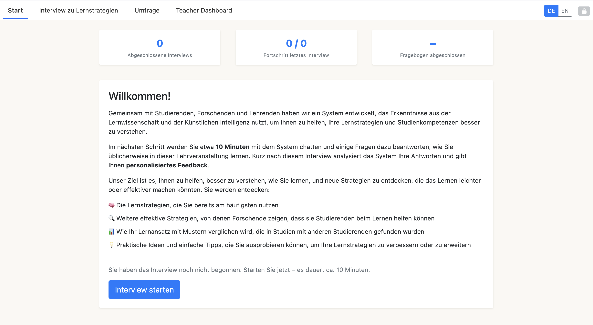
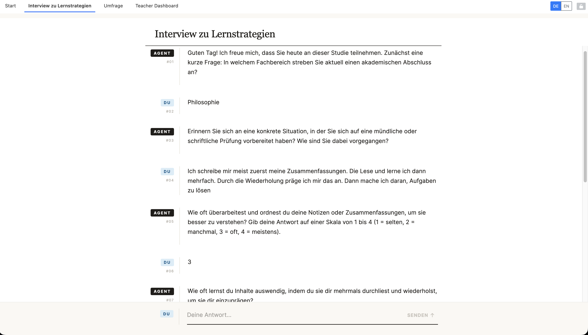
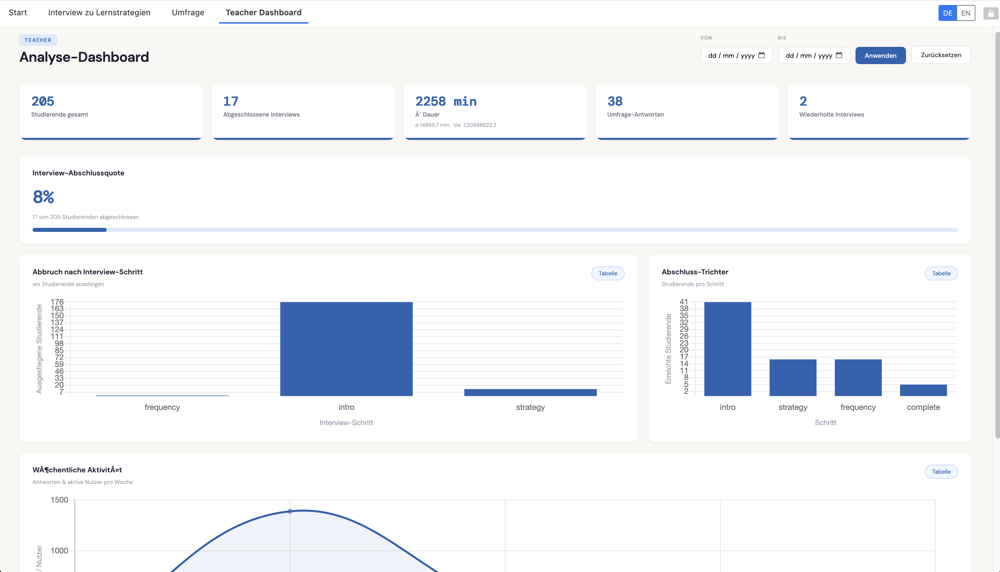
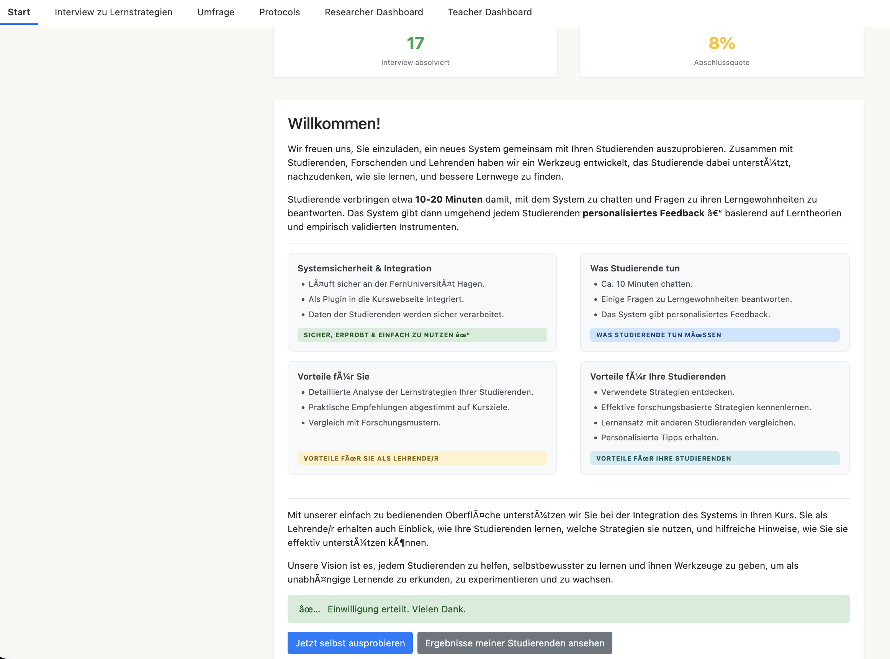
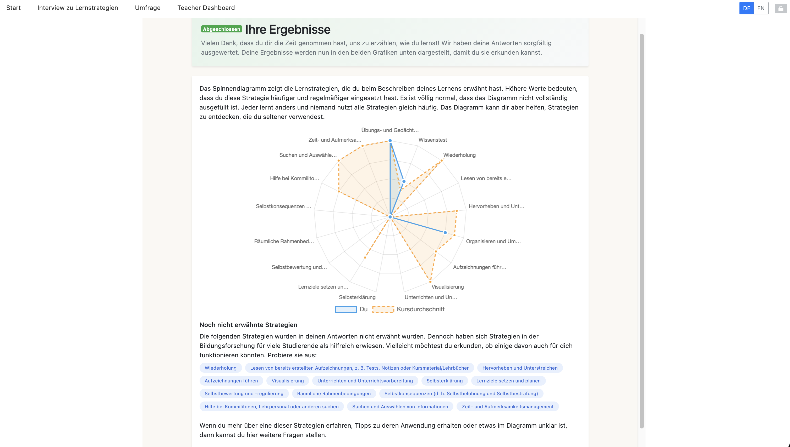
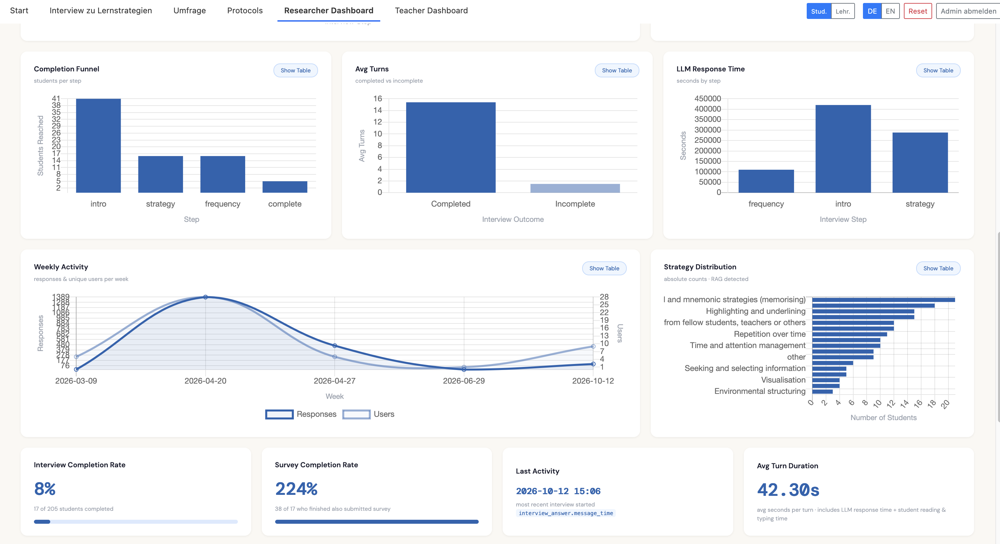

# SRL Agent: Ein KI-Interview für selbstreguliertes Lernen

Wie lernen Studierende eigentlich? Planen sie ihre Zeit bewusst, überprüfen sie ihr eigenes Verständnis, suchen sie sich Hilfe, wenn sie nicht weiterkommen? Diese Fragen stehen im Zentrum der Forschung zu selbstreguliertem Lernen (SRL) – und genau hier setzt der SRL Agent an: ein digitales Interview-Tool, das Studierende auf natürliche, gesprächsähnliche Weise zu ihren Lernstrategien befragt.

In diesem Beitrag stellen wir das Projekt vor – einmal für alle, die einfach verstehen wollen, was das Tool macht und wie es im Lehralltag eingesetzt werden kann, und einmal etwas tiefer für alle, die sich für die technische Umsetzung interessieren.

<figure>
  
  <figcaption>Abb. 1: Startseite des SRL Agent für Studierende</figcaption>
</figure>

---

## Für Lehrende: Was SRL Agent für den Unterricht bedeutet

Selbstreguliertes Lernen gilt als einer der stärksten Erfolgsfaktoren für gutes Lernen. Studierende, die ihre Lernprozesse planen, überwachen und anpassen können, kommen in der Regel besser durchs Studium. Nur: Wie findet man als Lehrperson heraus, welche Strategien die eigenen Studierenden tatsächlich nutzen?

Genau dabei hilft SRL Agent. Studierende führen ein kurzes, geführtes Gespräch mit dem System – auf Deutsch oder Englisch, ganz wie es passt. Das Tool fragt nach typischen Lernsituationen, etwa wie beim Lernen für eine Prüfung oder beim Schreiben einer Hausarbeit vorgegangen wird, und erkennt daraus automatisch, welche Lernstrategien zum Einsatz kommen. Anschließend geben die Studierenden noch an, wie häufig sie eine Strategie nutzen. Am Ende erhalten sie eine persönliche Zusammenfassung der von ihnen genutzten und noch nicht genutzten Lernstrategien. Der Agent geht dabei flexibel auf die individuellen Antworten der Studierenden ein, stellt bei Bedarf gezielte Rückfragen und greift bereits Gesagtes im weiteren Verlauf wieder auf – so gleicht kein Interview dem anderen.

<figure>
  
  <figcaption>Abb. 2: Geführtes Interview zu Lernstrategien im Chat</figcaption>
</figure>

Für Lehrende entsteht daraus ein Dashboard mit einer Übersicht über die Ergebnisse der eigenen Studierenden. So lässt sich auf einen Blick erkennen, wo eine Gruppe insgesamt steht, und die eigene Lehre gezielter darauf abstimmen – zum Beispiel durch zusätzliche Hinweise zur Zeitplanung oder zu Lernstrategien in der Lehrveranstaltung, wenn sich zeigt, dass viele Studierende hier Unterstützung gebrauchen könnten.

<figure>
  
  <figcaption>Abb. 3: Dashboard für Lehrende mit einer Übersicht über die Ergebnisse des Kurses</figcaption>
</figure>

<figure>
  
  <figcaption>Abb. 4: Onboarding für Lehrende</figcaption>
</figure>

<figure>
  
  <figcaption>Abb. 5: Persönliche Ergebnisübersicht für Studierende</figcaption>
</figure>

Wichtig für den Einsatz im Studienalltag: SRL Agent lässt sich direkt in bestehende Lernplattformen wie Moodle oder Ilias einbinden, sodass Studierende es ganz normal im gewohnten Kursraum nutzen können. Vor dem Start werden alle Teilnehmenden über Zweck und Nutzen des Systems informiert und müssen aktiv zustimmen. Am Ende können sie ihre eigenen Ergebnisse einsehen und herunterladen. Der SRL Agent kann im Verlauf eines Semesters auch mehrfach verwendet werden.

Das System wurde bereits in einem realen Kurs mit Studierenden eingesetzt und hat sich dabei im Praxisbetrieb bewährt.

---

## Für technisch Interessierte: Ein Blick auf das System

SRL Agent basiert auf dem klassischen strukturierten Interview zur Erfassung selbstregulierten Lernens von Zimmerman und Martinez-Pons (1986). Dieses etablierte Protokoll wurde in ein interaktives, mehrstufiges Gesprächssystem übersetzt, das Studierende durch Einleitung, Strategieerkennung, Häufigkeitsbewertung und eine automatisch generierte Zusammenfassung führt.

Ein zentrales technisches Element ist die automatische Erkennung von Lernstrategien aus den freien Antworten der Studierenden. Optional kommt dafür ein RAG-Ansatz (Retrieval-Augmented Generation) zum Einsatz: Antworten werden mittels Embeddings in einer Vektordatenbank (pgvector) mit bekannten Strategiebeschreibungen abgeglichen, wodurch auch frei formulierte Antworten zuverlässig einer Strategie zugeordnet werden können.

Alle Interaktionen werden persistent gespeichert – Gesprächsverläufe, erkannte Strategien, Häufigkeitsbewertungen sowie ein detailliertes Aktivitätslog der Nutzung (Klicks, Seitenaufrufe, eingegebene Zeichen). Diese Daten bilden die Grundlage für die Dashboards, die sowohl Forschenden als auch Lehrenden zur Verfügung stehen.

Für den Einsatz in unterschiedlichen Kontexten unterstützt SRL Agent mehrere Deployment-Modi: als eigenständige Webanwendung, als LTI-Tool zur Einbindung in Plattformen wie Moodle oder Ilias, sowie als vollständiger Docker-Compose-Stack für den einfachen Betrieb. Optional lässt sich zudem eine Discord-Anbindung für Benachrichtigungen aktivieren.

Die benötigte Infrastruktur skaliert dabei überschaubar mit der Nutzungsgröße: Für einen campusweiten Einsatz mit über hundert gleichzeitigen Studierenden skaliert das System auf einem relativ kleinem Server mit 4 GB RAM und üblichen CPU-Kapazitäten. Ein separater Server für das eigentliche Sprachmodell wird in jedem Fall zusätzlich benötigt. Im Projekt greifen wir im Sinne der Digitalen Souveränität auf das von KI:connect bereitgestellte französiche Model Mistral-small 119b zurück.

_[Screenshot architektur.png: Architektur- oder Systemübersicht einfügen, falls vorhanden]_

---

## Wissenschaftlich fundiert und praktisch erprobt

SRL Agentist kein reines Technikprojekt, sondern eng mit unserer Forschung bei CATALPA zu selbstreguliertem Lernen verzahnt. Der Ansatz, das klassische Interviewprotokoll von Zimmerman und Martinez-Pons mithilfe generativer KI umzusetzen, wurde in mehreren wissenschaftlichen Beiträgen vorgestellt und diskutiert, unter anderem im Journal of Research on Technology in Education, auf der International Conference on Education Technology and Computers 2025 und zuletzt auf der Learning Analytics & Knowledge 2026. Wer tiefer in die theoretischen und methodischen Hintergründe einsteigen möchte, findet in diesen Veröffentlichungen ausführliche Einblicke in Entwicklung und Evaluation des Ansatzes.

- Seidel, N., & Radovic, S. (n.d.). Measuring and Promoting Self-Regulation with Agentic AI and Learning Analytics. Companion Proceedings 16th International Conference on Learning Analytics & Knowledge (LAK26).
- Radović, S., Seidel, N., & Wetchy, E. (2025). Implementing the self-regulated learning structured interview protocol with generative AI: A novel approach for evaluating students’ SRL skills. Journal of Research on Technology in Education, 1–18. https://doi.org/10.1080/15391523.2025.2547176
- Radovic, S., Wetchy, E., & Seidel, N. (2025). An AI-based Chat Agent for Measuring Students’ Self-Regulated Learning Skills. 2025 International Conference on Education Technology and Computers (ICETC), 169–173. https://doi.org/10.1109/ICETC66579.2025.11387673
- Seidel, N., Wetchy, R., Radovic, S., Prasoon, T., & Emsilkh, A. (2026). SRL Agent: Software for Conversational Assessment of Self-Regulated Learning [Computer software]. CATALPA, FernUniversität in Hagen.
- Wetchy, E., Radovic, S., & Seidel, N. (2026). Entwicklung und Evaluation eines generativen Gesprächsagenten zur Erfassung selbstregulierten Lernens. 24. Fachtagung Bildungstechnologien (DELFI 2026).
- Wetchy, E. (2024). An AI-Based Chat Agent to Support Students’ Self-Regulated Learning Skills (Ausgezeichnet als Beste Masterarbeit der Fachgruppe Bildungstechnologie der Gesellschaft für Informatik). FernUniversität in Hagen.

In der aktuellen Version von SRL Agent ist auch eine angepasste Variante des SRL-O Fragebogens integriert. Auf diese Weise können wir die Ergebnisse des Interviews mit etablierten Fragebogeninstrumenten und auch Verhaltsdaten aus dem LMS triangulieren.

Entwickelt wurde SRL Agent von einem kleinen, interdisziplinären Team: Dr. Niels Seidel (Projektleitung, Entwicklung/Technologie), Dr. Slavisa Radovic (Projektleitung, SRL-Experte), Elisabeth Wetchy (Entwicklerin des initialen Prototypen), Prasoon Tiwari und Abdulrouf Emsilkh.

<figure>
  
  <figcaption>Abb. 6: Dashboard für Forschende</figcaption>
</figure>

## Fazit

SRL Agent verbindet ein bewährtes psychologisches Forschungsinstrument mit moderner Interviewtechnologie und macht es so praktisch nutzbar – für die Forschung ebenso wie für den Lehralltag. Der erste Praxiseinsatz in einem Kurs mit Studierenden hat gezeigt, dass sich das Tool gut in bestehende Lernumgebungen integrieren lässt und wertvolle Einblicke in das Lernverhalten liefert. Ob als eigenständige Anwendung, eingebunden in Moodle oder Ilias, oder als flexibel skalierbarer Docker-Stack für ganze Kursreihen – SRL Agent lässt sich an ganz unterschiedliche Einsatzszenarien anpassen, vom kleinen Pilotversuch bis zum campusweiten Einsatz.

Wer mehr über das Projekt erfahren möchte oder Interesse an einem Einsatz in der eigenen Lehre hat, ist herzlich eingeladen, sich zu melden.

[DEMO-Anwendung](https://srl-agent.fernuni-hagen.de/#/)

[LTI-Installetionsanleitung via GitHub](https://github.com/CATALPAresearch/srl-agent)

Projektwebseite bei [KI-Edu-NRW](https://ki-edu-nrw.ruhr-uni-bochum.de/ueber-das-projekt/phase-2/praxis-transferprojekte/aktuelle-praxisprojekte/srl-agent/) und [CATALPA](https://www.fernuni-hagen.de/forschung/schwerpunkte/catalpa/forschung/projekte/SRL-Agent.shtml)

## Ausblick

Der SRL Agent wird im Wintersemester 2026/27 in weiteren Lehrveranstaltungen eingesetzt werden und anschließend evaluiert werden.
Perspektivisch kann das technische Infrastrukt von SRL Agent auch für die Durchführung anderer strukturierter Interviews genutzt werden. Das Konzept zur Erhebung qualitativer Daten mit Hilfe agentischer KI hat unsere Arbeitsgruppe indes auch auf die Durchführung von Think Aloud Protokollen angewendet. Inspiriert durch den KI:edu.nrw Ethikworkshop von Dominik Bär arbeiten wir zudem an einem EthicsCompanion, ein skriptgestütztes Reflexionswerkzeug, das Entwickler:innen und Designer:innen von Bildungstechnologie dabei unterstützt, ethische Fragestellungen bereits während des Entwicklungsprozesses gezielt zu reflektieren.
